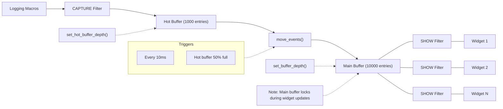

# tui-logger-kotlin in Kotlin

[](https://github.com/KotlinMania/tui-logger-kotlin)
[](https://central.sonatype.com/artifact/io.github.kotlinmania/tui-logger-kotlin)
[](https://github.com/KotlinMania/tui-logger-kotlin/actions)

This is a Kotlin Multiplatform line-by-line transliteration port of [`gin66/tui-logger`](https://github.com/gin66/tui-logger) (crate `tui-logger`).

**Original Project:** This port is based on [`gin66/tui-logger`](https://github.com/gin66/tui-logger). All design credit and project intent belong to the upstream authors; this repository is a faithful port to Kotlin Multiplatform with no behavioural changes intended.

### Porting status

This is an **in-progress port**. The goal is feature parity with the upstream Rust crate while providing a native Kotlin Multiplatform API. Every Kotlin file carries a `// port-lint: source <path>` header naming its upstream Rust counterpart so the AST-distance tool can track provenance.

---

## Upstream README — `gin66/tui-logger`

> The text below is reproduced from [`https://github.com/gin66/tui-logger`](https://github.com/gin66/tui-logger). It is the upstream project's own description and remains under the upstream authors' authorship; links have been rewritten to absolute upstream URLs where appropriate so they continue to resolve from this repository.

# tui-logger

<!-- cargo-rdme start -->

## Logger with smart widget for the `tui` and `ratatui` crate

[](https://deps.rs/repo/github/gin66/tui-logger)


### Demo of the widget


### Documentation

[Documentation](https://docs.rs/tui-logger/latest/tui_logger/)

I have stumbled over an excellent AI-generated description of `tui-logger`, which provides surprisingly deep and (mostly) correct implementation details.
It would have costed me many days to write an equally good description with so many details and diagrams.
This docu can be found [here](https://deepwiki.com/gin66/tui-logger).

### Important note for `tui`

The `tui` crate has been archived and `ratatui` has taken over.
In order to avoid supporting compatibility for an inactive crate,
the v0.9.x releases are the last to support `tui`. In case future bug fixes
are needed, the branch `tui_legacy` has been created to track changes to 0.9.x releases.

Starting with v0.10 `tui-logger` is `ratatui` only.

### Features

- [X] Logger implementation for the `log` crate
- [X] Logger enable/disable detection via hash table (avoid string compare)
- [X] Hot logger code only copies enabled log messages with timestamp into a circular buffer
- [X] Widgets/move_message() retrieve captured log messages from hot circular buffer
- [X] Lost message detection due to circular buffer
- [X] Log filtering performed on log record target
- [X] Simple Widgets to view logs and configure debuglevel per target
- [X] Logging of enabled logs to file
- [X] Scrollback in log history
- [x] Title of target and log pane can be configured
- [X] `slog` support, providing a Drain to integrate into your `slog` infrastructure
- [X] `tracing` support
- [X] Support to use custom formatter for log events
- [X] Configurable by environment variables
- [X] `wait()` / `wait_timeout()` signaling support via Condvar
- [ ] Allow configuration of target dependent loglevel specifically for file logging
- [X] Avoid duplicating of module_path and filename in every log record
- [ ] Simultaneous modification of all targets' display/hot logging loglevel by key command

### Smart Widget

Smart widget consists of two widgets. Left is the target selector widget and
on the right side the logging messages view scrolling up. The target selector widget
can be hidden/shown during runtime via key command.
The key command to be provided to the TuiLoggerWidget via transition() function.

The target selector widget looks like this:


It controls:

- Capturing of log messages by the logger
- Selection of levels for display in the logging message view

The two columns have the following meaning:

- Code EWIDT: E stands for Error, W for Warn, Info, Debug and Trace.
  + Inverted characters (EWIDT) are enabled log levels in the view
  + Normal characters show enabled capturing of a log level per target
  + If any of EWIDT are not shown, then the respective log level is not captured
- Target of the log events can be defined in the log e.g. `warn!(target: "demo", "Log message");`

### Smart Widget Key Commands
```rust
|  KEY     | ACTION
|----------|-----------------------------------------------------------|
| h        | Toggles target selector widget hidden/visible
| f        | Toggle focus on the selected target only
| UP       | Select previous target in target selector widget
| DOWN     | Select next target in target selector widget
| LEFT     | Reduce SHOWN (!) log messages by one level
| RIGHT    | Increase SHOWN (!) log messages by one level
| -        | Reduce CAPTURED (!) log messages by one level
| +        | Increase CAPTURED (!) log messages by one level
| PAGEUP   | Enter Page Mode and scroll approx. half page up in log history.
| PAGEDOWN | Only in page mode: scroll 10 events down in log history.
| ESCAPE   | Exit page mode and go back to scrolling mode
| SPACE    | Toggles hiding of targets, which have logfilter set to off
```

The mapping of key to action has to be done in the application. The respective TuiWidgetEvent
has to be provided to TuiWidgetState::transition().

Remark to the page mode: The timestamp of the event at event history's bottom line is used as
reference. This means, changing the filters in the EWIDT/focus from the target selector window
should work as expected without jumps in the history. The page next/forward advances as
per visibility of the events.

### Basic usage to initialize logger-system:
```rust
#[macro_use]
extern crate log;
//use tui_logger;

fn main() {
    // Early initialization of the logger

    // Set max_log_level to Trace
    tui_logger::init_logger(log::LevelFilter::Trace).unwrap();

    // Set default level for unknown targets to Trace
    tui_logger::set_default_level(log::LevelFilter::Trace);

    // code....
}
```

For use of the widget please check examples/demo.rs

### Demo

Run demo using termion:

```rust
cargo run --example demo --features termion
```

Run demo with crossterm:

```rust
cargo run --example demo --features crossterm
```

Run demo using termion and simple custom formatter in bottom right log widget:

```rust
cargo run --example demo --features termion,formatter
```

### Configuration by environment variables

`tui.logger` uses `env-filter` crate to support configuration by a string or an environment variable.
This is an opt-in by call to one of these two functions.
```rust
pub fn set_env_filter_from_string(filterstring: &str) {}
pub fn set_env_filter_from_env(env_name: Option<&str>) {}
```
Default environment variable name is `RUST_LOG`.

### `slog` support

`tui-logger` provides a `TuiSlogDrain` which implements `slog::Drain` and will route all records
it receives to the `tui-logger` widget.

Enabled by feature "slog-support"

### `tracing-subscriber` support

`tui-logger` provides a `TuiTracingSubscriberLayer` which implements
`tracing_subscriber::Layer` and will collect all events
it receives to the `tui-logger` widget

Enabled by feature "tracing-support"

### `wait()` / `wait_timeout()` signaling support

For applications that drive rendering from their own event loop and need
to know when to redraw the widget without polling, `tui-logger` exposes
`wait()` and `wait_timeout()`. The waiter is keyed on a monotonic index
that is bumped every time `move_events()` successfully transfers one or
more events. A call to `wait()` captures the current index and blocks
until it advances, then returns the new index. `wait_timeout()` does the
same with a deadline, returning `None` if the timeout expired.

```rust
loop {
    tui_logger::wait_timeout(Duration::from_millis(100));
    terminal.draw(|f| f.render_widget(&mut app, f.area()))?;
}
```

Enabled by feature "waiter"

### Custom filtering
```rust
#[macro_use]
extern crate log;
//use tui_logger;
use env_logger;

fn main() {
    // Early initialization of the logger
    let drain = tui_logger::Drain::new();
    // instead of tui_logger::init_logger, we use `env_logger`
    env_logger::Builder::default()
        .format(move |buf, record|
            // patch the env-logger entry through our drain to the tui-logger
            Ok(drain.log(record))
        ).init(); // make this the global logger
    // code....
}
```

### Custom formatting

For experts only ! Configure along the lines:
```rust
use tui_logger::LogFormatter;

let formatter = MyLogFormatter();

TuiLoggerWidget::default()
.block(Block::bordered().title("Filtered TuiLoggerWidget"))
.formatter(formatter)
.state(&filter_state)
.render(left, buf);
```
The example demo can be invoked to use a custom formatter as example for the bottom right widget.

<!-- cargo-rdme end -->

### Internals

For logging there are two circular buffers in use:
* "hot" buffer, which is written to during any logging macro invocation
* main buffer, which holds events to be displayed by the widgets.

The size of the "hot" buffer is 1000 and can be modified by `set_hot_buffer_depth()`.
The size of the main buffer is 10000 and can be modified by `set_buffer_depth()`.

Reason for this scheme: The main buffer is locked for a while during widget updates.
In order to avoid blocking the log-macros, this scheme is in use.

The copy from "hot" buffer to main buffer is performed by a call to `move_events()`,
which is done in a cyclic task, which repeats every 10 ms, or when the hot buffer is half full.

In versions <0.13 log messages may have been lost, if the widget wasn't drawn.



### THANKS TO

* [Florian Dehau](https://github.com/fdehau) for his great crate [tui-rs](https://github.com/fdehau/tui-rs)
* [Antoine Büsch](https://github.com/abusch) for providing the patches to tui-rs v0.3.0 and v0.6.0
* [Adam Sypniewski](https://github.com/ajsyp) for providing the patches to tui-rs v0.6.2
* [James aka jklong](https://github.com/jklong) for providing the patch to tui-rs v0.7
* [icy-ux](https://github.com/icy-ux) for adding slog support and example
* [alvinhochun](https://github.com/alvinhochun) for updating to tui 0.10 and crossterm support
* [brooksmtownsend](https://github.com/brooksmtownsend) Patch to remove verbose timestamp info
* [Kibouo](https://github.com/Kibouo) Patch to change Rc/Refcell to thread-safe counterparts
* [Afonso Bordado](https://github.com/afonso360) for providing the patch to tui-rs v0.17
* [Benjamin Kampmann](https://github.com/gnunicorn) for providing patch to tui-rs v0.18
* [Paul Sanders](https://github.com/pms1969) for providing patch in [issue #30](https://github.com/gin66/tui-logger/issues/30)
* [Ákos Hadnagy](https://github.com/ahadnagy) for providing patch in [#31](https://github.com/gin66/tui-logger/issues/31) for tracing-subscriber support
* [Orhun Parmaksız](https://github.com/orhun) for providing patches in [#33](https://github.com/gin66/tui-logger/issues/33), [#34](https://github.com/gin66/tui-logger/issues/34), [#37](https://github.com/gin66/tui-logger/issues/37) and [#46](https://github.com/gin66/tui-logger/issues/46)
* [purephantom](https://github.com/purephantom) for providing patch in [#42](https://github.com/gin66/tui-logger/issues/42) for ratatui update
* [Badr Bouslikhin](https://github.com/badrbouslikhin) for providing patch in [#47](https://github.com/gin66/tui-logger/issues/47) for ratatui update
* [ganthern](https://github.com/ganthern) for providing patch in [#49](https://github.com/gin66/tui-logger/issues/49) for tui support removal
* [Linda_pp](https://github.com/rhysd) for providing patch in [#51](https://github.com/gin66/tui-logger/issues/51) for Cell:set_symbol
* [Josh McKinney](https://github.com/joshka) for providing patch in
[#56](https://github.com/gin66/tui-logger/issues/56) for Copy on TuiWidgetEvent and
TuiLoggerWidget
* [nick42d](https://github.com/nick42d) for providing patch in
[#63](https://github.com/gin66/tui-logger/issues/63) for semver checks, [#74](https://github.com/gin66/tui-logger/pull/74) and [#87](https://github.com/gin66/tui-logger/issues/87)
* [Tom Groenwoldt](https://github.com/tomgroenwoldt) for providing patch in [#65](https://github.com/gin66/tui-logger/issues/65) for ratatui update
* [Kevin](https://github.com/doesnotcompete) for providing patch in [#71](https://github.com/issues/71)
* [urizennnn](https://github.com/urizennnn) for providing patch in [#72](https://github.com/issues/72)
* [Earthgames](https://github.com/Earthgames) for providing patch in [#84](https://github.com/issues/84) to fix panic for unicode characters

### Star History

[](https://star-history.dera.page/#gin66/tui-logger&Date)

License: MIT

---

## About this Kotlin port

### Installation

```kotlin
dependencies {
    implementation("io.github.kotlinmania:tui-logger-kotlin:0.1.0")
}
```

### Building

```bash
./gradlew build
./gradlew test
```

### Targets

- macOS arm64
- Linux x64
- Windows mingw-x64
- iOS arm64 / simulator-arm64 (Swift export + XCFramework)
- JS (browser + Node.js)
- Wasm-JS (browser + Node.js)
- Android (API 24+)

### Porting guidelines

See [AGENTS.md](AGENTS.md) and [CLAUDE.md](CLAUDE.md) for translator discipline, port-lint header convention, and Rust → Kotlin idiom mapping.

### License

This Kotlin port is distributed under the same license terms as the upstream [`gin66/tui-logger`](https://github.com/gin66/tui-logger). See [LICENSE](LICENSE) (and any sibling `LICENSE-*` / `NOTICE` files mirrored from upstream) for the full text.

Original work copyrighted by the tui-logger authors.  
Kotlin port: Copyright (c) 2026 Sydney Renee and The Solace Project.

### Acknowledgments

Thanks to the [`gin66/tui-logger`](https://github.com/gin66/tui-logger) maintainers and contributors for the original Rust implementation. This port reproduces their work in Kotlin Multiplatform; bug reports about upstream design or behavior should go to the upstream repository.
